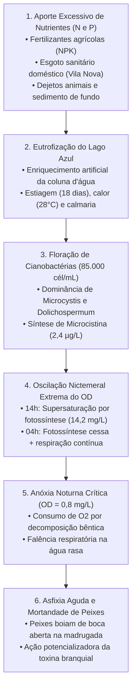

# FICHA DE ORIENTAÇÃO DO ESTUDANTE • DESAFIO 04
## "Floração Vermelha em Vale Verde: Eutrofização, Cianobactérias Tóxicas e Anóxia Noturna"

**Programa de Iniciação Científica no Ensino Médio • 1ª Série (BNCC)**  
**Metodologia:** Aprendizagem Baseada em Problemas (PBL – Problem-Based Learning)  
**Local:** Bacia do Lago Azul, Vale Verde  
**Duração:** 9 Aulas de 45 minutos  

---

## 1. Contextualização do Cenário Pericial

Nas primeiras horas da manhã, pescadores e frequentadores do **Lago Azul**, em Vale Verde, depararam-se com um evento atípico: uma extensa mancha com tonalidades verde-azuladas e avermelhadas cobriu a enseada rasa e a desembocadura do canal tributário, acompanhada de forte odor e faixas de escuma. Centenas de peixes (alevinos e adultos de tilápias, lambaris e traíras) foram encontrados mortos ou agonizando na beira d’água entre 4h e 6h da madrugada, boiando com a boca aberta na linha de superfície.

Paralelamente, boatos e notícias em redes sociais começaram a alegar a ocorrência de uma **"maré vermelha marinha"** causada pelo dinoflagelado marinho *Karenia brevis*. 

Sua equipe atuará como um grupo pericial de ecotoxicologia límnica para analisar os laudos técnicos, lâminas microscópicas, dados de qualidade de água e boletins hidrometeorológicos, formulando uma explicação científica consistente baseada em evidências.

---

## 2. As 6 Questões Investigativas Centrais

1. **Quais organismos estão proliferando no Lago Azul:** cianobactérias de água doce, microalgas eucarióticas ou uma comunidade fitoplanctônica mista?
2. **Quais nutrientes favoreceram essa proliferação** e quais são as fontes antrópicas prováveis na bacia hidrográfica?
3. **Há produção efetiva de toxinas (cianotoxinas, como microcistina)** no corpo hídrico? Em que concentrações?
4. **A mortandade de peixes está diretamente relacionada à intoxicação aguda por cianotoxinas, à asfixia por anóxia noturna ou à combinação sinérgica de ambos os fatores?**
5. **Por que o oxigênio dissolvido ($OD$) atinge níveis altíssimos de supersaturação durante a tarde e despenca drasticamente na madrugada?**
6. **O fenômeno pode ser classificado cientificamente como "maré vermelha"?** Como florações de água doce se diferenciam de florações marinhas causadas por dinoflagelados?

---

## 3. Catálogo de Organismos para Investigação e Comparação

> [!NOTE]
> Os organismos abaixo são candidatos para investigação e comparação comparativa didática. Nem toda floração é tóxica e nem toda linhagem de espécie potencialmente produtora expressa genes de toxinas (*mcy*).

### A. Cianobactérias de Água Doce (Procariontes)
- ***Microcystis aeruginosa:*** Células esféricas coloniais (3–5 µm) envoltas em mucilagem amorfa. Possui aerótopos (vesículas de gás) que permitem flutuação na superfície sob luz solar. Certas linhagens sintetizam **microcistinas** (hepatotoxinas).
- ***Dolichospermum circinale (antiga Anabaena):*** Filamentos espiralados ou lineares com presença de **heterócitos** (células especializadas na fixação de nitrogênio gasoso, $N_2$) e acinetos (células de resistência).
- ***Planktothrix agardhii:*** Filamentos retos verde-azulados, tolerantes a baixa luminosidade, produtores de microcistinas.
- ***Cylindrospermopsis raciborskii (Raphidiopsis raciborskii):*** Filamentos retos ou espiralados com heterócitos terminais, produtores de saxitoxinas ou cilindrospermopsinas.
- ***Aphanizomenon flos-aquae:*** Filamentos que formam feixes macroscópicos ("flocos de grama"), fixadores de $N_2$.

### B. Microalgas de Água Doce (Eucariontes)
- ***Scenedesmus spp.*** e ***Chlorella vulgaris:*** Clorófitas (algas verdes), providas de cloroplastos bem organizados, parede de celulose; não sintetizam cianotoxinas.
- ***Euglena viridis:*** Euglenófitas unicelulares flageladas com estigma (mancha ocular) avermelhado; podem colorir a água em tons vermelhos ou verdes sem produzir microcistinas.

### C. Organismos Marinhos para Comparação (Maré Vermelha Estrita)
- ***Karenia brevis:*** Dinoflagelado marinho eucariótico uniflagelado produtor de **brevetoxinas**. Causa marés vermelhas costeiras marinhas (ex: Golfo do México e litoral oceânico catarinense). **Não sobrevive nem prolifera em corpos d'água continentais doces (límnicos).**
- ***Alexandrium catenella*** e ***Gymnodinium spp.:*** Dinoflagelados marinhos produtores de saxitoxinas (paralisia por consumo de moluscos bivalves marinhos).

---

## 4. Cronograma de Liberação dos 12 Documentos (9 Aulas)

| Aula | Documentos Analisados | Foco Investigativo | Produto Esperado da Equipe |
|:---:|:---|:---|:---|
| **Aula 1** | **Doc 1:** Notícia da mancha e peixes mortos **Doc 2:** Boletim Meteorológico (calor, estiagem) | Apresentação do evento misterioso e condições meteorológicas | Formulação das 3 hipóteses iniciais |
| **Aula 2** | **Doc 3:** Laudo Físico-Químico (N e P no canal) **Doc 4:** Vistoria de Campo (3 fontes suspeitas) | Avaliação dos nutrientes e mapeamento das fontes na bacia | Mapa preliminar de fontes de contaminação |
| **Aula 3** | **Doc 5:** Microscopia de superfície (colônias) **Doc 6:** Microscopia de fitoplâncton filamentoso | Exame microscópico, heterócitos e morfologia | Quadro comparativo taxonômico de espécies |
| **Aula 4** | **Doc 7:** Laudo Toxicológico (microcistina 2,4 µg/L) | Cianotoxinas, dose de exposição e limites legais | Análise crítica do laudo de microcistina |
| **Aula 5** | **Doc 8:** Monitoramento 24h de Oxigênio ($OD$) | Ciclo nictemeral do $OD$ (14,2 mg/L vs 0,8 mg/L) | Gráfico do ciclo circadiano e explicação da anóxia |
| **Aula 6** | **Doc 9:** Necrópsia de peixes (asfixia branquial) **Doc 10:** Notícia viral de "maré vermelha marinha" | Ictiopatologia vs desinformação científica | Parecer técnico refutando fake news da maré vermelha |
| **Aula 7** | **Doc 11:** Testemunhos de sedimento bêntico | Decomposição bêntica e *internal loading* de fósforo | Modelo Causal em 6 etapas lógicas |
| **Aula 8** | **Doc 12:** Relatório Pericial Integrado Oficial | Síntese integrada de dados moleculares e químicos | Redação final do Parecer Técnico Pericial |
| **Aula 9** | *Todos os laudos e evidências acumuladas* | Defesa científica das conclusões e autoavaliação | Apresentação oral e rubrica avaliativa BNCC |

---

## 5. Estrutura do Modelo Causal em 6 Etapas

---

## 6. Itens Obrigatórios do Parecer Técnico Pericial (Aula 8/9)

1. **Identificação dos Organismos:** Diferenciação inequívoca entre cianobactérias límnicas e dinoflagelados marinhos.
2. **Explicação da Eutrofização:** Fontes de nitrogênio e fósforo identificadas na bacia hidrográfica.
3. **Interpretação do Ciclo Diário do Oxigênio:** Por que a água atinge 14,2 mg/L de dia e despenca para 0,8 mg/L às 4h da madrugada.
4. **Análise Toxicológica da Microcistina:** Detecção de 2,4 µg/L e comparação com o padrão de potabilidade (1,0 µg/L).
5. **Nexo Causal da Mortandade:** Articulação entre anóxia noturna como causa primária fulminante e cianotoxina como estressor celular.
6. **Esclarecimento à Comunidade:** Desmistificação científica da notícia de "maré vermelha marinha" no lago de água doce.
7. **Proposta de Mitigação e Manejo:** Medidas na bacia (saneamento básico em Vila Nova, bacias de contenção agrícola e monitoramento contínuo).
8. **Limitações do Estudo:** Quais análises adicionais seriam necessárias para monitorar a liberação interna de fósforo do sedimento.
